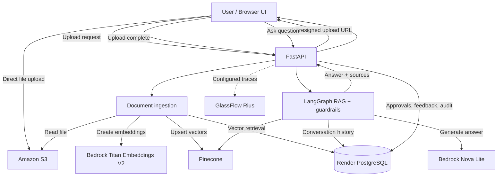
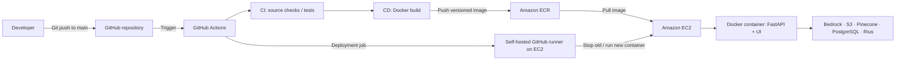

<div align="center">

# AGENTIC PRODUCTION AI

### Enterprise Knowledge Assistant with RAG, LangGraph, AWS Bedrock, and Automated AWS Deployment

**Document intelligence · Conversational memory · Guardrails · Human review · Observability · CI/CD**

[Overview](#overview) · [Architecture](#architecture) · [Quick Start](#quick-start) · [CI/CD Deployment](#cicd-deployment-to-aws) · [API](#api-reference) · [Security](#security-and-production-readiness)

</div>

---

## Overview

**Agentic AI** is a full-stack, educational enterprise knowledge assistant that answers natural-language questions over uploaded organizational documents using retrieval-augmented generation (RAG). It combines a FastAPI backend, LangGraph orchestration, Amazon Bedrock models, Pinecone vector search, and PostgreSQL-backed conversation history with an HTML/CSS/JavaScript interface.

The project demonstrates how to connect document ingestion, grounded question answering, safety checks, human-in-the-loop (HITL) review, operational auditing, and observability into one AI application. It also includes a deployment approach using **Docker, Amazon ECR, Amazon EC2, and GitHub Actions with a self-hosted runner**.

> **Project status:** Teaching/reference implementation. It is **not production-secure as shipped**: the demo identity context is not a real authentication or authorization system, approval decisions do not automatically execute destructive operations, and production-grade availability and rollback controls must be added separately.

## Key Features

| Capability | Description |
| --- | --- |
| Document ingestion | Browser uploads files directly to private Amazon S3 using presigned URLs; the backend processes and indexes them. |
| Enterprise RAG | Retrieve relevant chunks from Pinecone and generate grounded answers using Amazon Bedrock. |
| LangGraph workflow | Coordinate retrieval, generation, guardrail checks, and conversational context. |
| Conversation memory | Persist chat turns in PostgreSQL and reuse recent history for follow-up questions. |
| Guardrails | Apply deterministic input/output checks; behavior depends on the implemented rules. |
| HITL approvals | Queue selected sensitive/action-like requests for review and record approval decisions. |
| Audit and feedback | Store relevant application events and user feedback in PostgreSQL. |
| Observability | Optional GlassFlow Rius instrumentation for supported execution traces and diagnostics. |
| Web dashboard | Document upload, chat, history, approvals, and operational views in a lightweight UI. |
| Automated delivery | Build and publish versioned Docker images to ECR and deploy to EC2 through GitHub Actions. |

## Technology Stack

| Layer | Technology | Purpose |
| --- | --- | --- |
| Backend | Python, FastAPI, Uvicorn | APIs and application server |
| Frontend | HTML, CSS, JavaScript | Browser-based user interface |
| Orchestration | LangGraph | Stateful RAG workflow |
| LLM | Amazon Bedrock — Nova Lite | Response generation |
| Embeddings | Amazon Bedrock — Titan Text Embeddings V2 | Document and query vectors (1,024 dimensions in this project) |
| Vector database | Pinecone | Semantic retrieval and document chunk indexing |
| Object storage | Amazon S3 | Original uploaded documents |
| Relational database | PostgreSQL on Render | Document metadata, conversations, approvals, feedback, audit |
| Observability | GlassFlow Rius | Optional AI workflow tracing |
| Containerization | Docker | Portable application runtime |
| Image registry | Amazon ECR | Private Docker image storage |
| Compute | Amazon EC2 | Hosts the self-hosted runner and deployed container |
| CI/CD | GitHub Actions | Automated build, publish, and deployment |

## Architecture

### Application architecture



> **Ingestion note:** In the reference implementation, upload completion can perform ingestion synchronously. For larger documents and production traffic, move ingestion to a durable asynchronous worker or job service.

### AWS CI/CD deployment architecture



**Deployment flow:** A commit to `main` triggers GitHub Actions. The CI job runs configured checks; the delivery job builds and pushes an image tagged with the Git commit SHA to ECR. The deployment job runs on the trusted EC2 self-hosted runner, pulls that image, and replaces the application container. The instance needs outbound access to the external services.

## Repository Structure

```text
.
├── app/
│   ├── main.py                 # FastAPI routes and UI serving
│   ├── graph.py                # LangGraph workflow
│   ├── rag.py                  # RAG integration
│   ├── vector.py               # Pinecone operations
│   ├── aws.py                  # AWS clients
│   ├── db.py                   # PostgreSQL access and audit
│   ├── memory.py               # Conversation persistence
│   ├── guardrails.py           # Input/output safety checks
│   ├── observability.py        # Rius initialization
│   ├── config.py               # Runtime configuration
│   ├── templates/              # HTML templates
│   └── static/                 # CSS and JavaScript
├── worker/
│   └── ingest.py               # File processing and indexing
├── infra/
│   └── schema.sql              # Database schema
├── scripts/
│   └── init_db.py              # Database initialization
├── docs/                       # Setup and operational notes
├── requirements.txt
├── Dockerfile
├── .env.example
└── .github/workflows/         # GitHub Actions pipelines
```

> Repository layout reflects the project modules discussed here; keep this section aligned with the files in your actual GitHub repository. The CI/CD workflow must be added if it is not yet committed.

## Prerequisites

- Python 3.11+ and pip (use the version compatible with your dependencies)
- Docker Desktop or Docker Engine for container testing
- AWS account with access to S3 and the required Amazon Bedrock models
- Pinecone account and API key
- PostgreSQL database (the project uses Render)
- Optional GlassFlow Rius account
- For deployment: ECR repository, EC2 Linux instance, GitHub repository, and a registered self-hosted GitHub Actions runner

